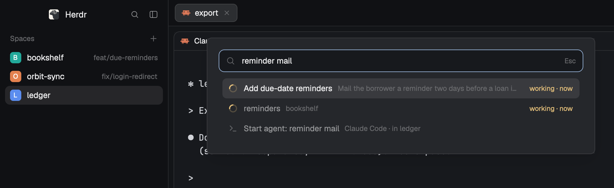
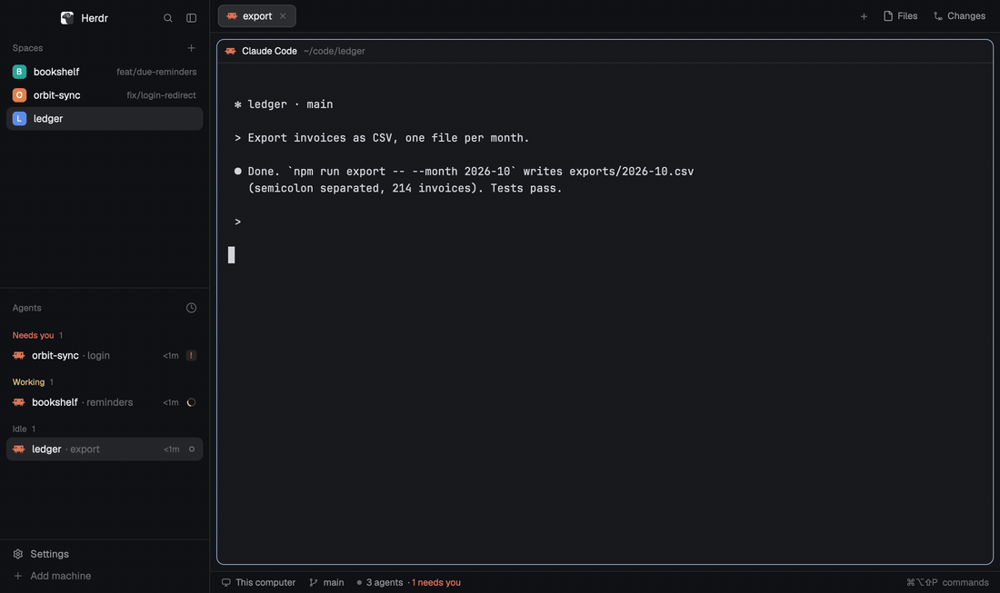
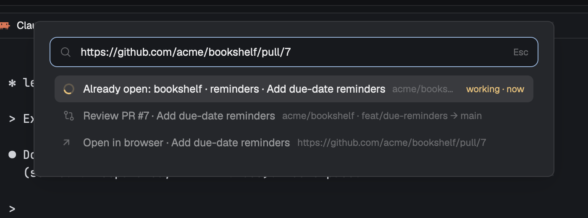
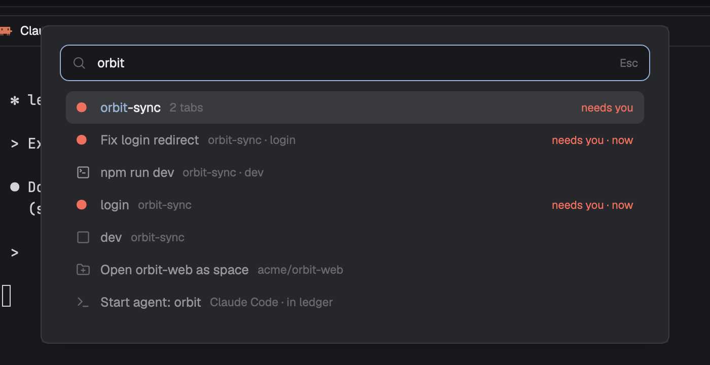
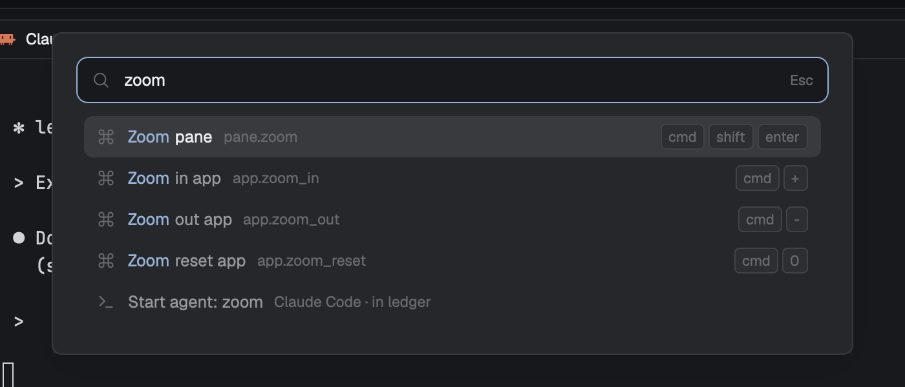
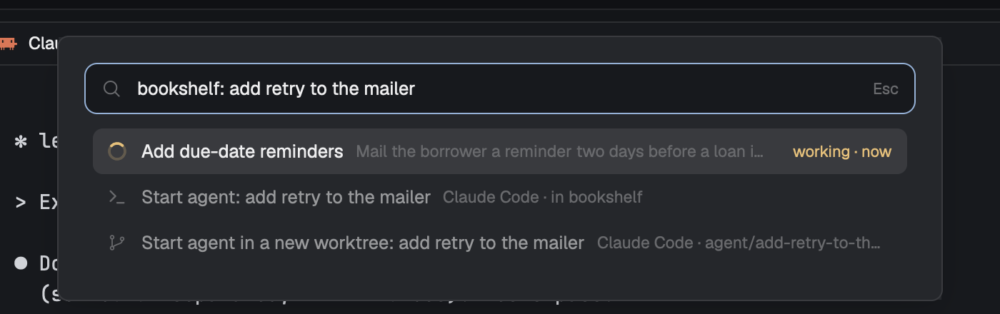

# Go to for Herdr

Part of [Corgi](https://github.com/saefty/herdr-corgi), a set of Herdr mods that plug into each other.

A ⌘⇧P box for Herdr that finds what you already have open before it opens anything new. Paste a PR link, type a
repo name or a few words from a session, and Enter takes you there.





## Use cases

- **You lost a session.** Type "reminder mail" and the agent working on due-date reminders comes up first, with the
  line that matched. No more opening a fifth tab for the same task.
- **Someone pastes a PR link in chat.** Paste it here. If you already have a space on that repo, Go to shows it; if
  a review mod is installed, it offers "Review PR".
- **You want to work on a repo.** Type part of its name. Go to finds the local clone under your code folders and
  opens it as a space, or shows the space that is already open there.
- **You want an agent on something.** Type what it should do ("bookshelf: add retry to the mailer") and Enter starts
  an agent with that as its task, in the named space or repo, else in the shown one. A second row does it in a new
  git worktree. If an open session already works on it, that session comes first.
- **You forgot a command.** Herdr's commands and layouts are in the same list.

## Screenshots









## Features

- Searches agents, terminals, tabs, spaces, local git repos, layouts and app commands in one list.
- Understands PR links, `owner/repo#123`, `repo#123`, `#123` (in the current repo), repo URLs, `owner/repo`,
  folders and other URLs. Finds the owner for a bare repo name from your clones.
- "Already open: …" comes first when what you ask for is open somewhere.
- "Start agent: <text>" starts the agent you pick most in Herdr with the text as its task, optionally in a new
  worktree (`~/.herdr/worktrees/<repo>/agent-<words>`, branch `agent/<words>`).
- Ranking without an LLM: fuzzy matching on names plus word matching on what other mods publish about a session,
  with simple stemming for English and German.
- Other mods can add items, claim inputs (a PR link becomes "Review PR"), switch a context before an action runs,
  and answer a natural-language "Ask" with one model call. The contract is in `mods/goto/PROVIDERS.md`. Without
  any of them Go to still works on its own.

## Works with

Go to, [PR review](https://github.com/saefty/herdr-corgi-pr-review) and the [chat bar](https://github.com/saefty/herdr-corgi-chatbar) each work alone. Installed together, they plug into each other:

- With **PR review**, a pasted PR link offers "Review PR" and opens it in the review layout, and reviews you started show up as "Resume review".
- With the **chat bar**, agents waiting on you show up as "Reply to …" and open their chat bubble.
- **Your own mod** can do the same: publish items, claim an input pattern, or switch a context (and the env agents start with) before an action runs. [PROVIDERS.md](mods/goto/PROVIDERS.md) has the contract with examples.

## Install

Copy `mods/goto` to `~/.config/herdr-app/mods/` and merge `keys.json` into `~/.config/herdr-app/keys.json`. It binds
⌘⇧P to Go to and moves Herdr's palette to ⌘⌥⇧P (its commands also show up in Go to). Then run
`herdr-app check ~/.config/herdr-app/mods/goto`.

It runs `git`, `find` and `gh` (for PR titles and owner lookup), and writes a small repo cache under
`~/.config/herdr-app/`.

## Settings

`~/.config/herdr-app/goto.config.json` (optional):

```json
{ "roots": ["~/code", "~/src"], "depth": 4, "cloneTo": { "default": "~/code" } }
```

`roots` are the folders searched for git repos, `depth` how deep, `cloneTo` where "Clone" puts a repo.

## Tests

`node --test mods/goto/test_goto.mjs`

## License

MIT
